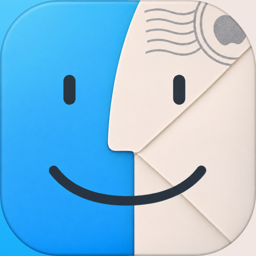
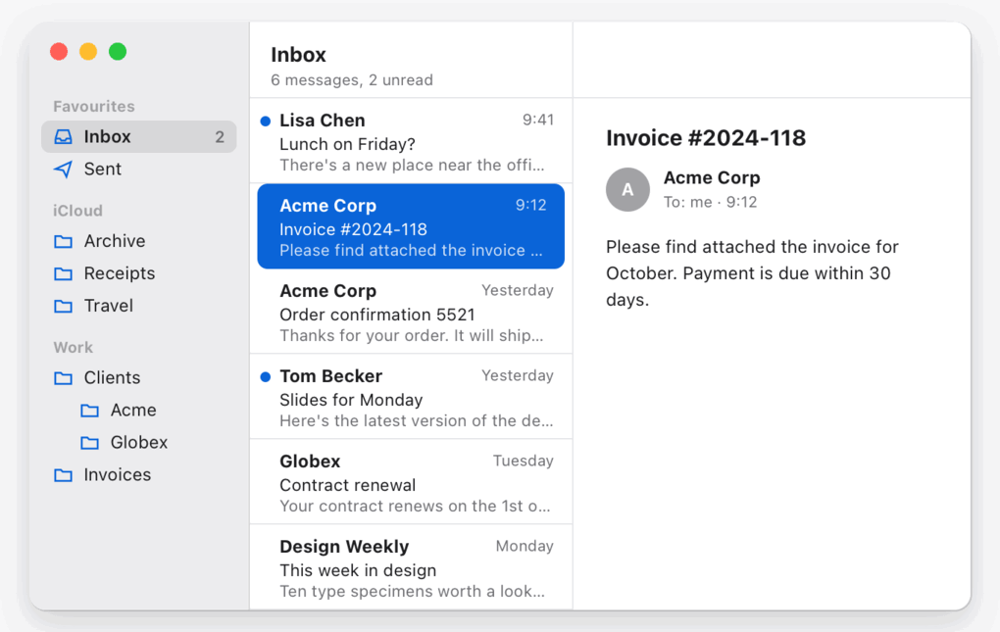

<p align="center">
  
</p>

<h1 align="center">Nostalgy-4-Mail 2.0</h1>

<p align="center">
  File your mail without touching the mouse.<br>
  Press <kbd>⌃S</kbd> in Apple Mail, type a few letters of any folder, press Return.<br>
  The message is filed and the next one is ready to read.
</p>

<p align="center">
  <a href="https://github.com/cubbi/Nostalgy-4-Mail-2.0/releases/latest/download/Nostalgy-4-Mail.zip"><b>Download for Mac</b></a>
  ·
  <a href="https://github.com/cubbi/Nostalgy-4-Mail-2.0/releases">All releases</a>
  ·
  <a href="https://cubbi.github.io/Nostalgy-4-Mail-2.0/">Website</a>
</p>

<p align="center">
  Free and open source · macOS 12 or later · MIT License
</p>

<p align="center">
  <picture>
    <source srcset="docs/demo-dark.gif" media="(prefers-color-scheme: dark)">
    
  </picture>
  <br>
  <sub><kbd>⌃S</kbd>, type “acm”, <kbd>↩</kbd>. Then <kbd>⌃⇧S</kbd> files the next one to the same folder.</sub>
</p>

## Shortcuts

Four keys, active only while Mail is in front:

| Keys | Action |
|------|--------|
| <kbd>⌃S</kbd> | Move the selected messages to a folder |
| <kbd>⌃C</kbd> | Copy the selected messages to a folder |
| <kbd>⌃G</kbd> | Go to a folder |
| <kbd>⌃⇧S</kbd> | Move to the folder you used last |

In the picker, use <kbd>↑</kbd> <kbd>↓</kbd> or <kbd>⇥</kbd> to choose, <kbd>↩</kbd> to confirm and
<kbd>esc</kbd> to cancel. Every shortcut can be changed in Settings.

## Features

1. **Type a few letters.** Find any folder by part of its name. Type several words to narrow it down,
   for example `arch 2024`.
2. **The next message is ready.** After a move, the message below is selected, just as in Mail itself.
   That works in All Inboxes too, across accounts.
3. **Recent folders first.** The folders you use most float to the top, so the right one is often
   already highlighted when the picker opens.
4. **Every account, every subfolder.** iCloud, Gmail, Exchange, any IMAP account and On My Mac.
   Nested folders show their full path, each listed once.
5. **Stays out of the way.** The shortcuts exist only while Mail is in front, so other apps keep theirs.
   It lives in the menu bar and needs no Accessibility access, only permission to control Mail.
6. **Quick from the first keystroke.** The folder list is kept on disk and refreshed in the background,
   so the picker opens at once, centred on Mail's window.
7. **Make it yours.** Change the shortcuts, hide folders such as Trash or Junk, choose how often folders
   are refreshed, and open it at login.

## Install

1. Download [**Nostalgy-4-Mail.zip**](https://github.com/cubbi/Nostalgy-4-Mail-2.0/releases/latest/download/Nostalgy-4-Mail.zip)
   from the latest release and open it.
2. Move **Nostalgy-4-Mail** to your Applications folder and open it.
3. **Confirm it once.** The app isn't notarized by Apple yet, so macOS says it can't verify it; click
   **Done**. Then open System Settings › Privacy & Security, scroll down and click **Open Anyway** next to
   Nostalgy-4-Mail. Or, in Terminal:
   ```sh
   xattr -dr com.apple.quarantine /Applications/Nostalgy-4-Mail.app
   ```
4. **Allow it to control Mail.** The first time you use it, macOS asks; click **OK**. If you clicked
   "Don't Allow", turn it on in System Settings › Privacy & Security › Automation.

### Build it yourself

It builds with Apple's free Command Line Tools. No Xcode project, no dependencies.

```sh
xcode-select --install   # once, if you don't have the Command Line Tools
git clone https://github.com/cubbi/Nostalgy-4-Mail-2.0.git
cd Nostalgy-4-Mail-2.0
./build.sh
cp -R build/Nostalgy-4-Mail.app /Applications/
open /Applications/Nostalgy-4-Mail.app
```

After a rebuild, macOS may ask again whether Nostalgy-4-Mail may control Mail.

## Settings

Open them from the menu-bar icon › **Settings…**. Changes apply immediately.

- **Shortcuts:** click one and press the new keys. A shortcut must include ⌃, ⌥ or ⌘.
  Press Delete to turn a shortcut off, Esc to cancel.
- **Hide folders:** a comma-separated list, for example `Trash, Junk, Archive/2019`.
  Any folder whose path contains one of these is left out of the picker.
- **Refresh folders:** how often the folder list is re-read from Mail while you use it,
  or only when you choose Refresh Folders in the menu.
- **Recent folders first:** how many recently used folders appear at the top of the picker.
- **Open Nostalgy-4-Mail at login:** macOS 13 and later.
- **Reset to Defaults**

## Why “4-Mail”?

Nostalgy is a much-loved Thunderbird add-on for filing mail from the keyboard.
[Version 1 of Nostalgy-4-Mail](https://github.com/cubbi/Nostalgy-4-Mail.app) brought it to Apple Mail
as a plug-in, from OS X Lion to Mavericks, but current macOS no longer loads Mail plug-ins.
Version 2.0 is a small menu-bar app that drives Mail through AppleScript instead.

## For developers

| Path | What it is |
|------|------------|
| `Sources/` | The app: hotkeys, folder picker, settings, and the AppleScript bridge to Mail |
| `build.sh` | Builds `build/Nostalgy-4-Mail.app` |
| `release.sh` | Builds and zips a release; `--publish` creates the GitHub release |
| `Resources/` | App icon: the approved artwork and the generated icon set |
| `tools/make-icon.swift` | Regenerates the icon set from the artwork |
| `docs/` | The website, published with GitHub Pages |
| `tools/demo/` | The animated demo: `scene.html` and `render.swift`, which turns it into the GIFs |

### Making a release

1. Set the version in `Info.plist` (`CFBundleShortVersionString` and `CFBundleVersion`).
2. Commit and push to `main`.
3. Run `./release.sh --publish`. It builds `build/Nostalgy-4-Mail.zip` and creates the GitHub
   release `v<version>` with the zip attached. It needs the GitHub CLI: `gh auth login`.

The zip has the same name in every release, so the download link,
`releases/latest/download/Nostalgy-4-Mail.zip`, always gets the newest version.

### Website

The website is in `docs/`. Publish it with GitHub Pages: Settings › Pages › Deploy from a branch,
`main`, folder `/docs`. It then lives at https://cubbi.github.io/Nostalgy-4-Mail-2.0/.

## License

MIT. See [LICENSE](LICENSE).

Made by [@Cubbi](https://x.com/Cubbi). Inspired by Nostalgy for Thunderbird.
